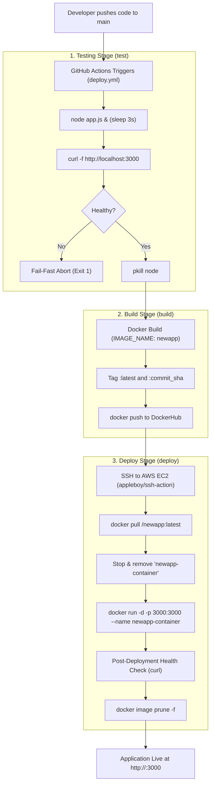

# Project Implementation Guide: Automated CI/CD Pipeline with AWS and GitHub Actions

**Project Title:** Automated CI/CD Pipeline with AWS and GitHub Actions  
**Student:** Shashank P M (USN: `4JN25MC089`)  
**Department:** Master of Computer Applications (MCA), JNNCE, Shivamogga  
**Affiliation:** Visvesvaraya Technological University (VTU), Belagavi  
**Internal Guide:** Mr. Prashant Ankalkoti (Assistant Professor)  
**Reference Repository:** [mchandhan/github-actions](https://github.com/mchandhan/github-actions)  

---

## 1. Project Directory Structure
All project files are organized in your active workspace at:
`/Users/shashankpm/Desktop/automated-cicd-pipeline`

```
automated-cicd-pipeline/
├── .github/
│   └── workflows/
│       └── deploy.yml         # GitHub Actions 3-Stage Workflow (test -> build -> deploy)
├── scripts/
│   ├── test.sh                # Automated Fail-Fast curl test runner
│   └── ec2-setup.sh           # AWS EC2 Docker environment provisioner
├── .dockerignore              # Excluded files during Docker build
├── .gitignore                 # Excluded files from Git version control
├── Dockerfile                 # Container image build (node:18 base)
├── app.js                     # Lightweight Node.js HTTP server (port 3000)
├── package.json               # Node.js project manifest & scripts
├── start.sh                   # Local one-click server runner
├── README.md                  # Project overview & documentation
└── PROJECT_IMPLEMENTATION_GUIDE.md # This guide
```

The raw reference repository clone is available at:  
`/Users/shashankpm/Desktop/mchandhan-github-actions`

---

## 2. Integrated Architecture & Pipeline Flow



---

## 3. Core File Breakdown

### 3.1 Workflow: `.github/workflows/deploy.yml`
* **Configuration:**
  * `IMAGE_NAME: newapp`
  * `CONTAINER_NAME: newapp-container`
* **Stage 1 (test):** Runs on `ubuntu-latest`. Spins up the server in the background, waits 3 seconds, runs `curl -f http://localhost:3000`, and cleans up the node process.
* **Stage 2 (build):** Authenticates to DockerHub using `secrets.DOCKER_USERNAME` and `secrets.DOCKER_PASSWORD`. Builds the container image and tags it twice: `:latest` and `:${{ github.sha }}` for full traceability.
* **Stage 3 (deploy):** Uses `appleboy/ssh-action@v1.0.3` to connect to the AWS EC2 instance. Pulls the new image, gracefully replaces `newapp-container`, performs a health check, and cleans up old image layers with `docker image prune -f`.

### 3.2 Containerfile: `Dockerfile`
```dockerfile
FROM node:18

WORKDIR /app

COPY . .

EXPOSE 3000

CMD ["node", "app.js"]
```

### 3.3 Server: `app.js`
* Built using the native `http` module with zero external dependencies.
* Listens on `PORT = process.env.PORT || 3000`.
* Default route `/` returns `"Hello, Node.js!\n"`.
* `/health` route returns `{"status":"UP", "timestamp":"..."}`.
* Implements `SIGTERM` and `SIGINT` signals for container lifecycle management.

---

## 4. AWS EC2 & DockerHub Setup Walkthrough

### 4.1 Launching the AWS EC2 Instance
1. In AWS Console -> **EC2** -> **Launch Instance**.
2. **Name:** `newapp-server`.
3. **OS Image (AMI):** Ubuntu Server 24.04 LTS or 22.04 LTS.
4. **Instance Type:** `t2.micro` or `t3.micro` (Free Tier).
5. **Key Pair:** Create or select a key pair (e.g. `cicd-key.pem`).
6. **Inbound Security Group Rules:**
   * **SSH:** Port `22` (Source `0.0.0.0/0` or your IP)
   * **Custom TCP:** Port `3000` (Source `0.0.0.0/0`)
7. Once launched, note your **Public IPv4 Address**.

### 4.2 Installing Docker on EC2
Connect to your EC2 instance:
```bash
chmod 400 cicd-key.pem
ssh -i "cicd-key.pem" ubuntu@<YOUR_EC2_PUBLIC_IP>
```
Run the automated provisioner script `scripts/ec2-setup.sh`:
```bash
curl -fsSL https://raw.githubusercontent.com/<YOUR_USER>/<REPO>/main/scripts/ec2-setup.sh | bash
```

### 4.3 DockerHub Configuration
1. Log in to [DockerHub](https://hub.docker.com/).
2. Create a repository named `newapp`.
3. Generate a Personal Access Token: **Account Settings -> Security -> New Access Token**.

### 4.4 GitHub Secrets Configuration
In your GitHub repository, open **Settings -> Secrets and variables -> Actions -> New repository secret**:

| Secret Name | Value | Description |
| :--- | :--- | :--- |
| `DOCKER_USERNAME` | `your_dockerhub_username` | DockerHub username |
| `DOCKER_PASSWORD` | `dckr_pat_...` | DockerHub Personal Access Token |
| `SERVER_HOST` | `13.233.xx.xx` | AWS EC2 Public IPv4 Address |
| `SERVER_USER` | `ubuntu` | Remote server username |
| `SERVER_SSH_KEY` | Contents of `cicd-key.pem` | Full private key including `-----BEGIN RSA...` |

---

## 5. Local Execution & Testing

* **Start the server locally:**
  ```bash
  cd /Users/shashankpm/Desktop/automated-cicd-pipeline
  ./start.sh
  ```
* **Verify endpoints:**
  * Root: `http://localhost:3000/` -> `Hello, Node.js!`
  * Health: `http://localhost:3000/health` -> `{"status":"UP"}`

---

## 6. Viva & Presentation Defense Topics

> **Q: Why are both `:latest` and Git commit SHA tags generated?**  
> **A:** The `:latest` tag allows deployment environments to pull the newest release automatically. The Git commit SHA provides **immutable traceability**, allowing engineers to trace running production containers back to specific source code commits and roll back instantly if needed.

> **Q: What constitutes the Fail-Fast mechanism?**  
> **A:** If the curl endpoint check fails during Stage 1 (`test`), the workflow aborts immediately with exit code 1. This prevents wasted runner time and guarantees broken code never gets built into Docker images or deployed to AWS.

> **Q: How is credential security preserved?**  
> **A:** All sensitive data (Docker credentials, EC2 IP, and SSH keys) are stored encrypted in **GitHub Secrets**, injected as environment variables during pipeline execution, and automatically masked in GitHub Actions logs.

